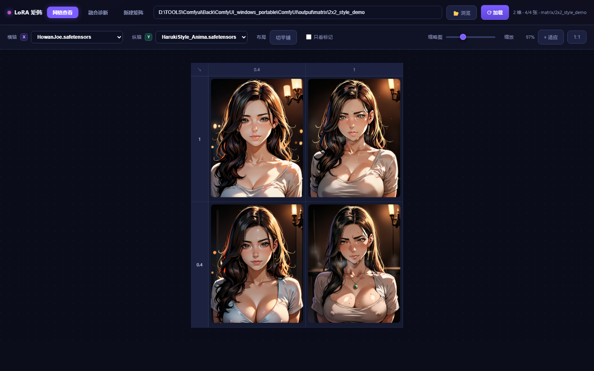
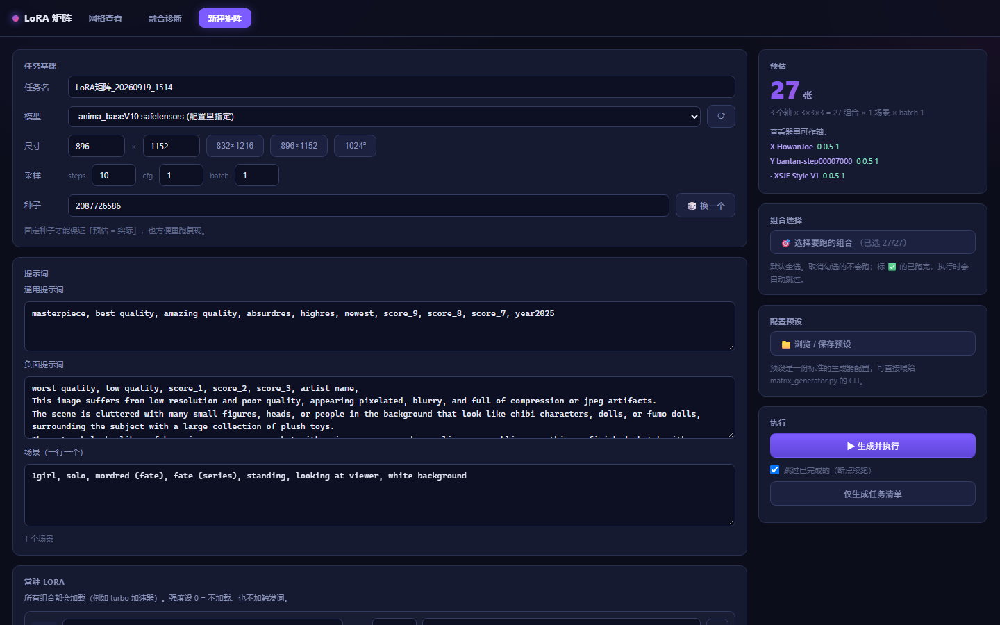
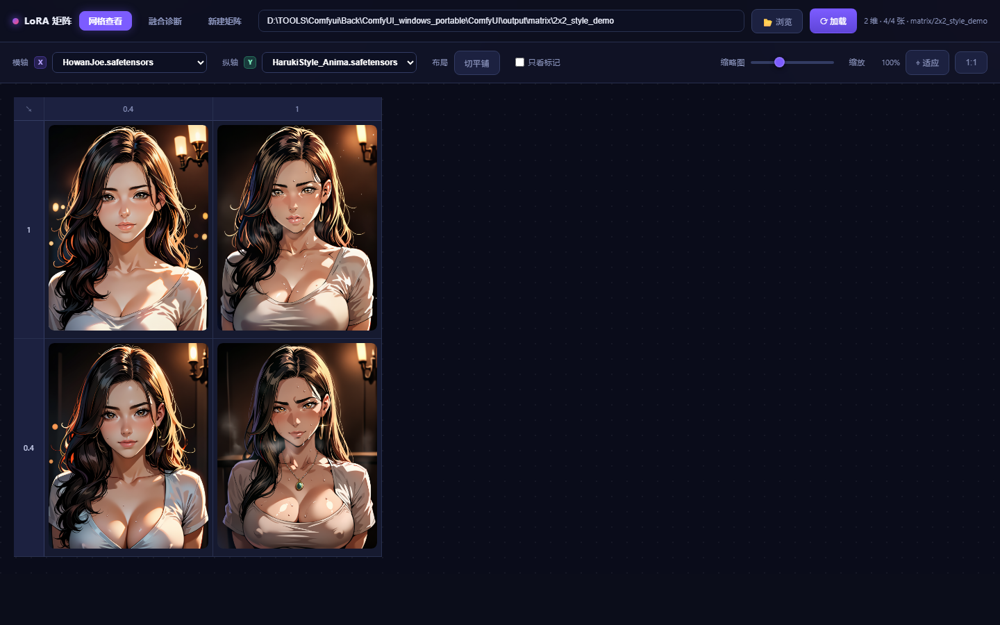

# LoRA 矩阵测试台

批量对比多个 LoRA 在不同强度下的组合效果。配置一次，跑完几十上百个组合，
然后用网格浏览结果、让工具给出融合质量诊断。

整个工具就是**这一个文件夹**，不需要安装。

---

## 它解决什么

在 ComfyUI 里想测「3 个 LoRA 各试 3 档强度」，意味着手动改 27 次参数再点 27 次生成，
跑完还得自己一张张翻看比较。

这个工具把整条链路接起来：

- **批量生成** — 配置一次，自动展开强度组合、逐个提交 ComfyUI
- **组合选择** — 只跑你挑的那几个；支持按维度值筛选、Shift 连选、拖拽刷选
- **断点续跑** — 跑一半断了/停了，重开自动跳过已完成的组合
- **N 维网格查看** — 任意选 2 个 LoRA 当横纵轴，其余维度当过滤器实时切换
- **平铺模式** — 再选一个维度铺开成多个小网格，一次看 3 个维度
- **融合诊断** — 自动分析：哪些 LoRA 有效、哪些组合可能崩了、
  强度加到多少饱和、**哪两个 LoRA 互相干扰**
- **画布缩放** — 滚轮无级缩放（锚定鼠标位置）、中键拖拽平移，像 CAD 一样

---

## 界面

**N 维网格查看** —— 任选两个 LoRA 当横纵轴，其余维度当过滤器实时切换。
数字是强度档位，点任意一格看大图：



**点图看全部参数** —— 这张图用了哪些 LoRA、各自什么强度、采样参数、
实际加载的权重、正负面提示词，一眼看全（省得回头翻日志）：


**新建矩阵** —— 左边填任务/提示词/LoRA，右边实时告诉你「预估 N 张」，
并列出哪些 LoRA 可以作为轴。点「生成并执行」直接开跑：



**画布可无级缩放** —— 滚轮缩放（锚定鼠标位置）、中键拖拽平移，像 CAD 一样。
243 张图也能一屏看全，想细看就滚轮推上去：



> **融合诊断**（第三个页签）用同一批图的颜色/纹理特征回答四个问题：
> LoRA 有没有效果、哪些组合崩了、强度加到多少饱和、哪两个 LoRA 互相干扰。
> 它会给出结论表格 + 一个「只跑这些去复核」按钮，直接把你怀疑的组合勾好带到生成页。

---

## 前置条件

### 1. ComfyUI 插件（缺一不可）

| 插件 | 用到的节点 |
|---|---|
| [rgthree-comfy](https://github.com/rgthree/rgthree-comfy) | `Power Lora Loader`、`Seed` |
| [ComfyUI-Impact-Pack](https://github.com/ltdrdata/ComfyUI-Impact-Pack) | `ImpactWildcardProcessor` |
| [comfyui-lora-manager](https://github.com/willmiao/ComfyUI-Lora-Manager) | `Save Image (LoraManager)` |
| [comfyui-image-saver](https://github.com/audioscavenger/save-image-extended-comfyui) | `UNet loader with Name` |

> 进「新建矩阵」页时工具会自检，缺哪个会直接列出来。

### 2. Impact-Pack 需要的额外 pip 包

```bash
python -m pip install scikit-image opencv-python-headless piexif dill segment-anything
```

### 3. 模型

**工具不预设任何模型** —— 底模、CLIP、VAE 三项都在「新建矩阵」页里选，
用的是你自己 ComfyUI 里的文件：

| 项 | 从哪扫 | 常见目录 |
|---|---|---|
| **模型**（底模） | `diffusion_models/` `unet/` `checkpoints/` | UNet 或整包 checkpoint |
| **CLIP** | `clip/` `text_encoders/` | 文本编码器 |
| **VAE** | `vae/` | — |

外加你要测的 **LoRA**（放 `models/loras/`）。

> **`workflow.json` 是模板，注意它跟模型家族是绑的。**
> 默认那份是 Anima 栈（`UNet loader with Name` + `CLIPLoader` + `VAELoader`）。
> 换别的模型家族（SDXL / Pony / SD1.5 …）要替换模板里的加载节点 ——
> `task_runner` 会按节点类型自动决定写 `unet_name` 还是 `ckpt_name`，
> 但节点本身得由你换成对应的加载器。
>
> 三个模型名在配置里留空时，就沿用模板里的值。

---

## 配置 ComfyUI 路径（第一次用必须做）

工具要知道你的 ComfyUI 在哪。三选一，**优先级从上到下**：

**① 环境变量**（推荐，一次设定）

```bat
set COMFYUI_DIR=D:/ComfyUI_windows_portable/ComfyUI
```

**② 配置文件** — 把 `config.json.example` 复制成 `config.json`，改里面的路径：

```json
{ "comfyui_dir": "D:/ComfyUI_windows_portable/ComfyUI" }
```

**③ 什么都不做** — LoRA 列表会是空的。工具会在「新建矩阵」页弹红字警告提醒你，
看到就回去做 ① 或 ②。

### 自检

```bash
python paths.py
```

输出形如（`来源` 说明用的是哪一档）：

```
ComfyUI 目录: D:\ComfyUI_windows_portable\ComfyUI  (来源: config.json)
  LoRA 目录: D:\ComfyUI_windows_portable\ComfyUI\models\loras
```

---

## 用法

```bash
python matrix_viewer.py
```

浏览器打开 `http://127.0.0.1:18890`（会自动弹），三个标签页：

| 标签 | 做什么 |
|---|---|
| **网格查看** | 浏览已生成的矩阵。选 X/Y 轴、过滤其余维度；平铺模式看 3 维；滚轮缩放、中键拖动；点图看大图与元数据 |
| **融合诊断** | 选好矩阵目录后自动分析，给出四项诊断结论 |
| **新建矩阵** | 配置 LoRA 与强度 → 生成任务清单 → 直接开跑（带进度） |
| **任务队列** | 管理 `json/` 下攒下的多份任务清单：看每份**从磁盘数出来的**完成度，勾选多份按顺序跑，随时停止 |

> **任务队列页签**适合「一次安排好几批」。完成度是**数输出目录里的图**得来的（不是记的），
> 所以重启后重新勾一下就行 —— 而且有「跳过已完成」，重跑是安全的、不会重复出图。

命令行方式也保留：

```bash
python matrix_generator.py _test_2x2.json   # 配置 → 任务清单
python task_runner.py                        # 执行 json/ 下最新那份清单
```

> 本目录里的 `_test_2x2.json` 是一个现成的 2×2 示例配置，可以直接拿来试。

---

## 强度配置怎么填

每个矩阵 LoRA 的强度有三种模式：

| 模式 | 填什么 | 效果 |
|---|---|---|
| **固定** | `0.5` | 不进网格，只作为常量参与 |
| **范围** | 最小 `0` 最大 `1` 段数 `3` | 成为轴，展开成 `0 / 0.5 / 1` |
| **列表** | `0, 0.33, 0.8, 1` | 成为轴，原样使用（适合不等距取值） |

**想让 LoRA 数量多但不撑爆组合数，就把不想扫的设成「固定」。**

### 常用字段

| 字段 | 说明 |
|---|---|
| `base_model` / `clip_name` / `vae_name` | 这三个模型名，留空则用 `workflow.json` 模板里的值 |
| `常驻lora` | 每张图都加载、不进网格（如加速 LoRA） |
| `触发词` | 拼进正面提示词；**强度为 0 时不加** |
| `包含全零基线` | 是否额外生成一张「不加任何被测 LoRA」的对照图 |
| `场景` | 场景提示词列表，每个场景各跑一遍完整矩阵 |

---

## 输出在哪

图片与 `task.json` 都写在 **ComfyUI 的 `output/matrix/{任务名}/`** 下，
查看器直接读那个目录 —— 不需要额外导出。

---

## 常见问题

**LoRA / 模型列表是空的** — 九成是 ComfyUI 路径没配对。跑 `python paths.py` 看 `来源`，
显示 `解析失败` 就说明没读到你的配置。

**启动就报 `ModuleNotFoundError`** — 确认是在本目录下运行；本工具的所有模块都在同一层。

**点「浏览文件夹」没反应** — ComfyUI 便携版自带的 Python 不含 tkinter，
这个按钮会自动降级，手填路径即可。

**「缺少 N 个节点」** — 上面 4 个插件没装齐，提示里会写明缺哪个。

---

## 依赖与许可

**本工具自身**只依赖 `Pillow` + `numpy`（ComfyUI 环境通常已自带），通过 HTTP 调用
ComfyUI 的 API，**不链接、不包含 ComfyUI 的代码**。以 MIT 许可发布，见 [LICENSE](LICENSE)。

**它依赖的外部项目各自独立授权**，需要的话请自行核对：

| 项目 | 说明 |
|---|---|
| [ComfyUI](https://github.com/comfyanonymous/ComfyUI) | **GPL-3.0** |
| [rgthree-comfy](https://github.com/rgthree/rgthree-comfy) | 见其仓库 |
| [ComfyUI-Impact-Pack](https://github.com/ltdrdata/ComfyUI-Impact-Pack) | 见其仓库 |
| [comfyui-lora-manager](https://github.com/willmiao/ComfyUI-Lora-Manager) | 见其仓库 |
| [comfyui-image-saver](https://github.com/audioscavenger/save-image-extended-comfyui) | 见其仓库 |

> 如果你要**连 ComfyUI 一起打包分发**（例如做成整合包），那一部分适用 GPL-3.0 ——
> 需要保留其 LICENSE 并提供对应源码的获取方式。
