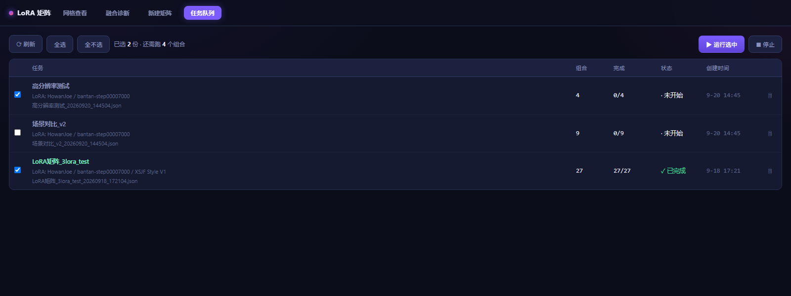

# LoRA 矩阵测试台

批量对比多个 LoRA 在不同强度下的组合效果。配置一次，跑完几十上百个组合，
然后用网格浏览结果、让工具给出融合质量诊断。

整个工具就是**这一个文件夹**，不需要安装。

---

## 它解决什么

在 ComfyUI 里想测「3 个 LoRA 各试 3 档强度」，意味着手动改 27 次参数再点 27 次生成，
跑完还得自己一张张翻看比较。

这个工具把整条链路接起来：

- **批量生成** — 配置一次，自动展开强度组合、逐个提交 ComfyUI
- **组合选择** — 只跑你挑的那几个；支持按维度值筛选、Shift 连选、拖拽刷选
- **断点续跑** — 跑一半断了/停了，重开自动跳过已完成的组合
- **N 维网格查看** — 任意选 2 个 LoRA 当横纵轴，其余维度当过滤器实时切换
- **平铺模式** — 再选一个维度铺开成多个小网格，一次看 3 个维度
- **融合诊断** — 自动分析：哪些 LoRA 有效、哪些组合可能崩了、
  强度加到多少饱和、**哪两个 LoRA 互相干扰**
- **画布缩放** — 滚轮无级缩放（锚定鼠标位置）、中键拖拽平移，像 CAD 一样

---

## 界面

**N 维网格查看** —— 任选两个 LoRA 当横纵轴，其余维度当过滤器实时切换。
数字是强度档位，点任意一格看大图：


**点图看全部参数** —— 这张图用了哪些 LoRA、各自什么强度、采样参数、
实际加载的权重、正负面提示词，一眼看全（省得回头翻日志）：


**新建矩阵** —— 左边填任务/提示词/LoRA，右边实时告诉你「预估 N 张」，
并列出哪些 LoRA 可以作为轴。点「生成并执行」直接开跑：


**画布可无级缩放** —— 滚轮缩放（锚定鼠标位置）、中键拖拽平移，像 CAD 一样。
243 张图也能一屏看全，想细看就滚轮推上去：


**任务队列** —— `json/` 下会攒下好几份任务清单（不同配置生成的）。这里把它们列出来，
每份显示**完成度**，勾选多份就能按顺序跑：



> 完成度是**数出来的**，不是记出来的 —— 它去看输出目录里存不存在对应的图。
> 所以不需要任何记录文件，重启后重新勾一下就行；配合「跳过已完成」，重跑也不会重复出图。

> **融合诊断**（第二个页签，**可卸载的插件**，见「插件」一节）用同一批图的颜色/纹理特征回答四个问题：
> LoRA 有没有效果、哪些组合崩了、强度加到多少饱和、哪两个 LoRA 互相干扰。
> 它会给出结论表格 + 一个「只跑这些去复核」按钮，直接把你怀疑的组合勾好带到生成页。

---

## 下载

### ① 整合包 —— **新手直接下这个**

**已经配好 ComfyUI + 全部必需插件 + 模型环境的便携版**，解压即用。
下面「前置条件」那一节列的东西（ComfyUI 本体、四个自定义节点、依赖库、模型）
里面**全都装好了**，不用自己折腾。

- 夸克网盘：<https://pan.quark.cn/s/832830ecd47e>
- 提取码：`9pFU`

> 包比较大（ComfyUI + 模型）。**建议用夸克 App 下载** —— 网页版非会员可能限速。
>
> 说句实话：走这个网盘下载会给作者带来一点收益。这工具是业余时间做的，
> 算是支持 —— 但也**不必**为此付费或开会员，见下面 ② 。

### ② 只要工具本体

**[MatrixLoRATest.zip](https://github.com/shiruixa/matrix_lora_test/releases/latest)**
（约 37 MB，**不含 ComfyUI**）—— 你自己已经有配好的 ComfyUI 就下这个。
从 GitHub 下载，比网盘快、也没限速。

用法：解压 → **双击 `MatrixLoRATest.exe`** → 浏览器自动打开。
关掉它请点**页面右上角的「退出」**（关浏览器标签不会关掉它）。

---

## 前置条件

> **这段是给「已经有 ComfyUI、但没装过这些插件」的人看的。**
> 用了上面的整合包就可以跳过整节。

### 1. ComfyUI 插件（缺一不可）

| 插件 | 用到的节点 |
|---|---|
| [rgthree-comfy](https://github.com/rgthree/rgthree-comfy) | `Power Lora Loader`、`Seed` |
| [ComfyUI-Impact-Pack](https://github.com/ltdrdata/ComfyUI-Impact-Pack) | `ImpactWildcardProcessor` |
| [comfyui-lora-manager](https://github.com/willmiao/ComfyUI-Lora-Manager) | `Save Image (LoraManager)` |
| [comfyui-image-saver](https://github.com/audioscavenger/save-image-extended-comfyui) | `UNet loader with Name` |

> 进「新建矩阵」页时工具会自检，缺哪个会直接列出来。

### 2. Impact-Pack 需要的额外 pip 包

```bash
python -m pip install scikit-image opencv-python-headless piexif dill segment-anything
```

### 3. 模型

**工具不预设任何模型** —— 底模、CLIP、VAE 三项都在「新建矩阵」页里选，
用的是你自己 ComfyUI 里的文件：

| 项 | 从哪扫 | 常见目录 |
|---|---|---|
| **模型**（底模） | `diffusion_models/` `unet/` `checkpoints/` | UNet 或整包 checkpoint |
| **CLIP** | `clip/` `text_encoders/` | 文本编码器 |
| **VAE** | `vae/` | — |

外加你要测的 **LoRA**（放 `models/loras/`）。

> **`workflow.json` 是模板，注意它跟模型家族是绑的。**
> 默认那份是 Anima 栈（`UNet loader with Name` + `CLIPLoader` + `VAELoader`）。
> 换别的模型家族（SDXL / Pony / SD1.5 …）要替换模板里的加载节点 ——
> `task_runner` 会按节点类型自动决定写 `unet_name` 还是 `ckpt_name`，
> 但节点本身得由你换成对应的加载器。
>
> 三个模型名在配置里留空时，就沿用模板里的值。

---

## 配置 ComfyUI 路径（多半不用管）

工具要知道你的 ComfyUI 在哪。**它会先问正在运行的那台 ComfyUI**
（`GET /internal/folder_paths`）—— 所以如果你只装一个、且服务跑着，
常常**什么都不用配**。

> 这一档的意义在于**多个便携版并存**时：连哪个端口，就拿到那台的路径。
> 模型目录被 `extra_model_paths.yaml` 重定向到别的盘、ComfyUI 装在移动硬盘上
> 盘符变了，服务端自己都知道。旧版 ComfyUI 没有这个端点 → 自动退回下面的
> 配置方式，行为不变。

问不到时，按下面的顺序来：

**① 环境变量**（推荐，一次设定）

```bat
set COMFYUI_DIR=D:/ComfyUI_windows_portable/ComfyUI
```

**② 配置文件** — 把 `config.json.example` 复制成 `config.json`，改里面的路径：

```json
{ "comfyui_dir": "D:/ComfyUI_windows_portable/ComfyUI" }
```

**③ 什么都不做** — LoRA 列表会是空的。工具会在「新建矩阵」页弹红字警告提醒你，
看到就回去做 ① 或 ②。

> **ComfyUI 装在移动硬盘上？** 那 ②（`config.json`）比 ① 更合适 ——
> 盘符是会变的，钉死一个环境变量下次换个口插就成了 `G:` → `H:`。
> `config.json` 就在工具目录里，换机器/换盘符时改一行。
>
> 盘没插时工具会明确告诉你「兜底路径 X 不存在（移动硬盘没插？或盘符变了）」，
> 而不是让你去猜为什么 LoRA 列表是空的。

### 自检

```bash
python paths.py
```

输出形如（`来源` 说明用的是哪一档）：

```
ComfyUI 目录: D:\ComfyUI_windows_portable\ComfyUI  (来源: config.json)
  LoRA 目录: D:\ComfyUI_windows_portable\ComfyUI\models\loras
```

---

## 用法

**双击 `LoRA矩阵测试台.exe`** 就行。浏览器会自动打开，没有控制台窗口。

- 启动时会**扫一遍本机在跑的 ComfyUI**（端口 8188-8199），扫到就直接用；
  扫到多个就在工具栏那个下拉里选（每一项都带着**那台自己的路径**，好区分）
- 扫不到也不影响用 —— 浏览已有结果照常；工具栏会显示「未找到 ComfyUI」
- `18890` 被占（比如不小心开了两个）会自动顺延，并在启动日志里说明

三个标签页：

| 标签 | 做什么 |
|---|---|
| **网格查看** | 浏览已生成的矩阵。选 X/Y 轴、过滤其余维度；平铺模式看 3 维；滚轮缩放、中键拖动；点图看大图与元数据 |
| **融合诊断** | 选好矩阵目录后自动分析，给出四项诊断结论（**插件，可卸载** —— 见「插件」一节） |
| **新建矩阵** | 配置 LoRA 与强度 → 生成任务清单 → 直接开跑（带进度） |
| **任务队列** | 管理 `json/` 下攒下的多份任务清单：看每份**从磁盘数出来的**完成度，勾选多份按顺序跑，随时停止 |

> **双击没反应？** 看同目录的 `启动日志.txt` —— 全部诊断信息都在里面
> （没有控制台窗口，所以日志写在文件里）。

### 怎么关掉它

**点页面右上角的「⏻ 退出」**。

> ⚠️ **关掉浏览器标签不会关掉它** —— 工具是独立进程，标签页只是它的界面。
> 只关标签的话它还在后台占着端口，你再双击一次就会开出第二个实例
> （端口自动顺延到 18901，两个同时在跑，你会搞不清在看哪个）。
>
> 万一按钮不管用（比如页面已经断开），用**任务管理器**结束 `MatrixLoRATest.exe`：
> `Ctrl+Shift+Esc` → 找到它 → 右键「结束任务」。

> **任务队列页签**适合「一次安排好几批」。完成度是**数输出目录里的图**得来的（不是记的），
> 所以重启后重新勾一下就行 —— 而且有「跳过已完成」，重跑是安全的、不会重复出图。

命令行方式也保留：

```bash
python matrix_generator.py _test_2x2.json   # 配置 → 任务清单
python task_runner.py                        # 执行 json/ 下最新那份清单
```

> 本目录里的 `_test_2x2.json` 是一个现成的 2×2 示例配置，可以直接拿来试。

---

## 强度配置怎么填

每个矩阵 LoRA 的强度有三种模式：

| 模式 | 填什么 | 效果 |
|---|---|---|
| **固定** | `0.5` | 不进网格，只作为常量参与 |
| **范围** | 最小 `0` 最大 `1` 段数 `3` | 成为轴，展开成 `0 / 0.5 / 1` |
| **列表** | `0, 0.33, 0.8, 1` | 成为轴，原样使用（适合不等距取值） |

**想让 LoRA 数量多但不撑爆组合数，就把不想扫的设成「固定」。**

### 常用字段

| 字段 | 说明 |
|---|---|
| `base_model` / `clip_name` / `vae_name` | 这三个模型名，留空则用 `workflow.json` 模板里的值 |
| `常驻lora` | 每张图都加载、不进网格（如加速 LoRA） |
| `触发词` | 拼进正面提示词；**强度为 0 时不加** |
| `包含全零基线` | 是否额外生成一张「不加任何被测 LoRA」的对照图 |
| `场景` | 场景提示词列表，每个场景各跑一遍完整矩阵 |

---

## 输出在哪

图片与 `task.json` 都写在 **ComfyUI 的 `output/matrix/{任务名}/`** 下，
查看器直接读那个目录 —— 不需要额外导出。

---

## 插件

### 怎么装、怎么卸

插件就是 `plugins/` 下面的**一个文件夹**（就在 exe 旁边）。没有安装程序，
不用命令行：

| 想做什么 | 怎么做 |
|---|---|
| **装** | 把插件的**文件夹**拷进 `plugins/`，重启工具 |
| **卸载** | 删掉 `plugins/<插件名>/` 整个文件夹，重启工具 |
| **临时停用**（不删） | 在文件夹名前面加个下划线：`analysis` → `_analysis`，重启 |
| **恢复** | 把下划线去掉，重启 |

> ⚠️ **解压后别多套一层。** 从压缩包解压出来常见的是 `analysis-main/`，
> 而里面还有一层 `analysis/`。要把**里面那层**放进 `plugins/`，
> 不能整个 `analysis-main/` 直接扔进去 —— 否则工具找不到它。
>
> 真放错了也不会静默失败：启动日志会写
> 「子目录 analysis/ 里有 plugin.json —— 多半是解压多套了一层」，
> 并告诉你正确的放法。

### 目录长什么样

「融合诊断」是一个**可卸载的插件**，装在 `plugins/` 下：

```
plugins/
└── analysis/              ← 融合诊断。删掉这个目录 = 卸载
    ├── plugin.json        清单：名字 / 页签 / 依赖
    ├── __init__.py        页签内容 + 样式 + 脚本 + 路由
    ├── similarity.py      特征提取 + PCA
    ├── diagnose.py        四项诊断
    └── analysis.json.example
```

**卸载**：删掉 `plugins/analysis/` 整个目录，重启。工具照常跑，只是少了那个页签；
`/api/similarity` 会变成 404。**内核不 import 插件里的任何东西**，所以不会有残留
引用导致起不来。

**装回来**：把目录放回去，重启即可。

**缺依赖**：`plugin.json` 里的 `requires` 声明了需要的模块。缺任何一个 →
启动时控制台提示、**页签照常出现**但内容换成「未启用」+ 安装命令，路由不注册。
不会静默消失让你去猜。

**自己写一个**：`plugins/<名字>/` 放一个 `plugin.json`（至少要有 `id`），
外加一个 `__init__.py` 导出这些**可选**名字：

| 名字 | 类型 | 用途 |
|---|---|---|
| `BODY` | str | 页签内容 HTML（外壳由加载器按 `tab.id` 生成，别自己套 `<div id="tab-…">`） |
| `CSS` | str | 该页签样式 |
| `JS` | str | 该页签脚本，跑在 IIFE 里，**只能通过 `window.MLX` 与内核通信** |
| `routes()` | 函数 | 返回 `{路径: handler}`，handler 签名 `(handler实例, params)` |

JS 侧的接口（`MLX`）有：`api` / `getFolder()` / `getMarks()` / `switchTab()` /
`openTab` 等，外加 `registerTab()` / `on(事件)` / `expose()`。事件有
`folder-loaded`、`marks-changed`、`resize`。

> 页签按钮和容器都由加载器生成，所以**插件可以只提供 `BODY`**（静态说明页也成立）。
> 想看实例照抄 `plugins/analysis/`。

---

## 常见问题

**LoRA / 模型列表是空的** — 九成是 ComfyUI 路径没配对。跑 `python paths.py` 看 `来源`，
显示 `解析失败` 就说明没读到你的配置。

**启动就报 `ModuleNotFoundError`** — 确认是在本目录下运行；本工具的所有模块都在同一层。

**看不到「📂 浏览」按钮** — 正常的。ComfyUI 便携版自带的 Python 不含 tkinter，
弹不出系统文件夹对话框，所以**没有 tkinter 时这个按钮会直接隐藏**（而不是留个点了没用的）。
选目录请用工具栏下方的**快捷目录**：它会列出 ComfyUI `output/matrix` 下的所有任务目录，
点一下即加载。路径也可以直接粘到输入框里回车。

> 快捷目录不存在时（ComfyUI 还没跑过任何矩阵），说明 `output/matrix` 还不存在 ——
> 先按上面的「配置 ComfyUI 路径」把路径配对，然后在「新建矩阵」页签跑一次就有了。

**页面显示「连不上查看器服务」** — 查看器被重启或关掉了（改代码后重启、或手动停的），
而你浏览器里还是旧的那一份页面。按 **Ctrl+R** 刷新即可。

**「缺少 N 个节点」** — 上面 4 个插件没装齐，提示里会写明缺哪个。

---

## 依赖与许可

**本工具的内核**（浏览网格、生成任务清单、提交生图）只用 Python 标准库，
**零第三方依赖** —— 通过 HTTP 调用 ComfyUI 的 API，**不链接、不包含 ComfyUI 的代码**。
以 MIT 许可发布，见 [LICENSE](LICENSE)。

**「融合诊断」插件**额外需要 `numpy` + `Pillow`。
- **exe 版**：这两个库**已经打进去了**，开箱即用，不用装任何东西
- **源码版**：没装也能跑，只是那个页签会提示未启用 —— 见「插件」一节

> exe 里为什么必须打包：冻结环境里**没有 pip**，用户装不进去。
> 所以「缺依赖时提示 pip install」在 exe 里是骗人的 —— 代码里按模式分开提示
> （源码给 pip 命令，exe 说「本发布版没打包这个库」）。

**它依赖的外部项目各自独立授权**，需要的话请自行核对：

| 项目 | 说明 |
|---|---|
| [ComfyUI](https://github.com/comfyanonymous/ComfyUI) | **GPL-3.0** |
| [rgthree-comfy](https://github.com/rgthree/rgthree-comfy) | 见其仓库 |
| [ComfyUI-Impact-Pack](https://github.com/ltdrdata/ComfyUI-Impact-Pack) | 见其仓库 |
| [comfyui-lora-manager](https://github.com/willmiao/ComfyUI-Lora-Manager) | 见其仓库 |
| [comfyui-image-saver](https://github.com/audioscavenger/save-image-extended-comfyui) | 见其仓库 |

> 如果你要**连 ComfyUI 一起打包分发**（例如做成整合包），那一部分适用 GPL-3.0 ——
> 需要保留其 LICENSE 并提供对应源码的获取方式。
>
> **本项目的整合包（见「下载」）就属于这种情况**：包内**必须**保留 ComfyUI 的
> LICENSE 并标注上游源码地址 —— 这些文件不是可选的，删掉就不合规了。
